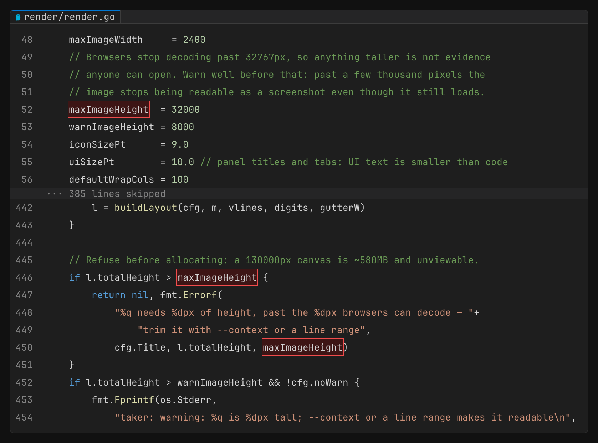
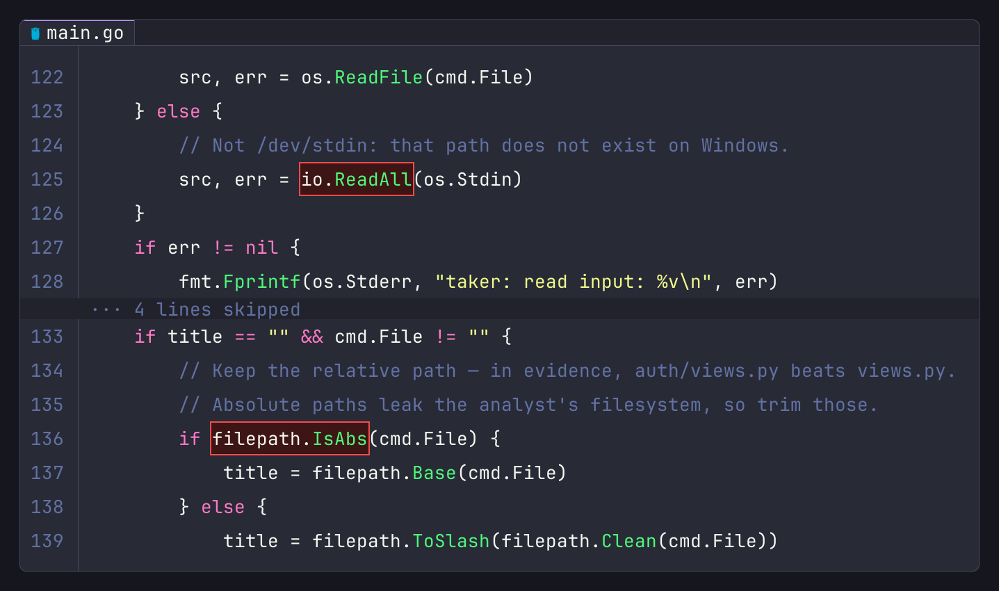
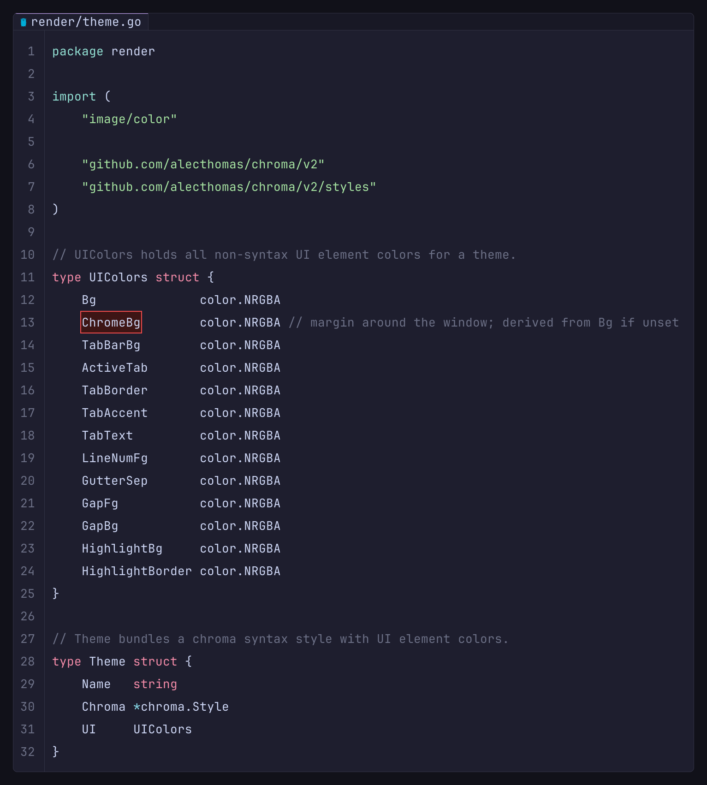
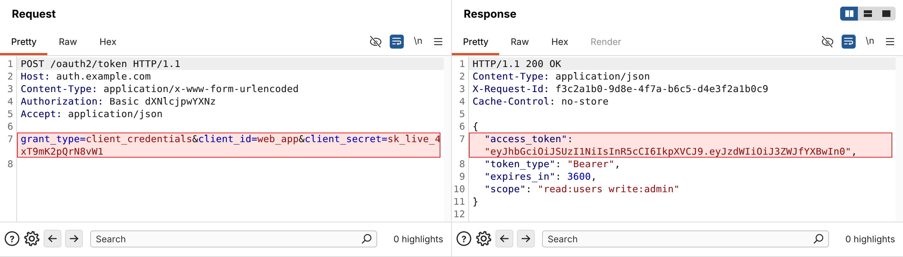

A CLI tool for generating professional, publication-ready code and HTTP evidence screenshots for security audits, SAST pipelines, MCP servers, and AI agents.

Produces VS Code Dark+-styled PNG images with syntax highlighting, line numbers, file icons, and red highlight overlays — without requiring a browser, Electron, or any GUI dependency. Single self-contained binary with embedded fonts.

---

## Installation

This fork is distributed as source. Build it locally:

```bash
cd pocing
go build -o pocing .
```

Requires Go 1.22+. The Go module path remains `github.com/anhtv-uwu/pocing` for
compatibility with upstream imports; the executable is named `pocing`.

---

## Features

- **VS Code Dark+ aesthetics** — window chrome with rounded corners, tab bar, gutter, syntax highlighting
- **Brand-colored file icons** — 260+ extensions and filenames (`Dockerfile`, `go.mod`, `.env`, `pom.xml`), each a real Nerd Fonts logo in its language color
- **10 built-in themes** — VS Code Dark+, Dracula, Nord, Catppuccin Mocha, GitHub Dark, Gruvbox, One Dark, Monokai, Solarized Dark, Rosé Pine
- **Line selection** — render only the lines you need (`1,5,10-20,30-40`), with gap bands stating how many lines were skipped
- **Context mode** — automatically include N lines around highlighted lines (`--context 5`)
- **Point at the finding, not the line** — mark a column range (`-H "7:63-85"`) or, better, paste the value itself (`-m "sk_live_4xT9mK2pQrN8vW1"`) and let `pocing` locate every occurrence
- **Code captions** — `-L` adds a strip stating what the code image proves, drawn outside the window so it never reads as something the tool under test printed
- **Word wrap** — wrap long lines with continuation indicators; wraps automatically rather than cropping
- **HTTP evidence mode** — side-by-side Request / Response pane that mimics Burp Suite's message editor, so evidence reads like a Burp screenshot
- **Stdin support** — pipe code directly without creating a temp file
- **Self-contained binary** — JetBrains Mono, DejaVu Sans Mono, Inter and Symbols Nerd Font are embedded; no runtime dependencies

---

## Usage

### Code evidence

```
pocing [file] [flags]
```

| Flag | Short | Default | Description |
|------|-------|---------|-------------|
| `--lang` | `-l` | auto | Language for syntax highlighting |
| `--lines` | `-n` | all | Lines to include, e.g. `1,5,10-20` |
| `--highlight` | `-H` | — | Regions to highlight in red: `15`, `13,15`, `10-20`, or `15:20-45` for columns |
| `--mark` | `-m` | — | Highlight every occurrence of this text. Repeatable |
| `--label` | `-L` | — | Caption stating what the image proves |
| `--context` | `-c` | 0 | Include N context lines around each highlighted line |
| `--wrap` | `-w` | false | Wrap long lines at a column boundary |
| `--wrap-width` | | 100 | Column width when wrapping (implies `--wrap`; floor 20) |
| `--title` | `-t` | file path | Title shown in the tab bar |
| `--theme` | `-T` | `vscode-dark` | Color theme |
| `--output` | `-o` | `output.png` | Output PNG path |
| `--list-themes` | | | Print available themes and exit |

#### Examples

```bash
# Render a full file
pocing auth.go -o evidence.png

# Highlight a specific vulnerability (line 42)
pocing auth.py -H 42 -o evidence.png

# Box the secret itself — no column counting
pocing auth.py -m "sk_live_4xT9mK2pQrN8vW1" -o evidence.png

# Or give the columns explicitly
pocing auth.py -H "42:18-41" -o evidence.png

# Caption it so the image explains itself in the report
pocing auth.py -m "sk_live_4xT9mK2pQrN8vW1" \
  -L "SOLTAU-005 · client secret hardcoded in the mobile build" -o evidence.png

# Highlight with 5 lines of context — ideal for SAST/AI agents
pocing auth.py -H 42 -c 5 -o evidence.png

# Non-contiguous lines with gap indicator
pocing config.go -n "1-10,45-60" -H "52,57" -o evidence.png

# Wrap long lines (e.g. YAML with inline comments)
pocing application.yml -H "13,15" -c 4 -w -o evidence.png

# From stdin
cat vuln.js | pocing -l javascript -t "vuln.js" -H 8 -o evidence.png

# Dracula theme
pocing secrets.py -H 15 -T dracula -o evidence.png
```

**Highlight + context (VS Code Dark+):**

```bash
pocing render/render.go -m "maxImageHeight" -c 4 -o evidence.png
```



**Dracula theme, two marks found by content:**

```bash
pocing main.go -m "io.ReadAll" -m "filepath.IsAbs" -c 3 -T dracula -o evidence.png
```



**Catppuccin Mocha, line selection plus a content mark:**

```bash
pocing render/theme.go -n "1-32" -m "ChromeBg" -T catppuccin-mocha -o evidence.png
```



### HTTP evidence

```
pocing http -r <request-file> -s <response-file> [flags]
```

Renders a side-by-side Request / Response pane built to look like Burp Suite's message editor: title strip, `Pretty | Raw | Hex` view tabs with the active one underlined, dense line spacing, a gutter with no rule, and wrapped rows left unnumbered the way Burp does it.

HTTP images contain only the Burp-style panels, with no caption strip underneath.

The default is Burp's **light** theme, fitted pixel-by-pixel against a real Burp Suite capture (`compare/compare_v3.py` scores it; `--dark` scores the dark theme): regular-weight DejaVu Sans Mono message text (`--bold` for the heavier cut), header names in navy with near-black values, cookie / query / form parameter names in blue and values in dark red, HTML tags in magenta with blue attributes, Inter Bold titles and Inter chrome, the orange `Pretty` underline, the eye-slash / blue wrap pill / `\n` / menu controls, the layout switch on the Response panel, a grey current-line band, the bottom search toolbar (`?`, gear, previous / next, *Search* field, *0 highlights*) and the scroll lane. HTML bodies are re-indented the way Burp's Pretty view shows them (`--raw-html` keeps them as sent). Rows word-wrap after a space, or after the `"` that opens an attribute value, with a hanging indent. Long panels are capped at 32 visible rows (`--max-lines`) with a scrollbar thumb positioned on the highlighted rows. `--theme dark` is Burp's macOS **dark** theme: the same layout, chrome and text rendering with every colour measured from a real dark-mode capture (pale-blue start line and header names, grey values, gold HTML tags, periwinkle attributes, green values, the blue wrap pill and layout switch, the `#2f3133` current-line band).

Message text is DejaVu Sans Mono (Menlo's freely licensed Bitstream Vera ancestor; Menlo itself is not shipped) at Burp's 13px, unhinted, forced onto Burp's 8px cells and with its baseline, x-height, cap and ascender snapped to whole pixels so it reads as compactly as Burp on macOS.

| Flag | Description |
|------|-------------|
| `-r` | File containing the raw HTTP request |
| `-s` | File containing the raw HTTP response |
| `--hr` | Regions to highlight in the request: `8-9`, or `8:20-45` for columns |
| `--hs` | Regions to highlight in the response: `4`, or `4:12-60` for columns |
| `--mark` / `-m` | Highlight every occurrence of this text in either panel. Repeatable |
| `--nr` | Lines to include from the request, e.g. `1-20` |
| `--ns` | Lines to include from the response, e.g. `1-30` |
| `-c` | Include N context lines around each highlighted line |
| `--wrap-width` | Columns per panel (default: 71) |
| `--theme` | `light` (default) or `dark` (`burp-light` / `burp-dark` / `burp` are accepted aliases) |
| `--bold` | Bold message text (Burp itself draws regular) |
| `--raw-html` | Show HTML bodies as sent instead of Burp's re-indented Pretty view |
| `--max-lines` | Visible rows per panel, default 32; longer panels get a scrollbar and the view centres on highlights (`0` = show everything) |
| `--caret-r` / `--caret-s` | Line carrying the grey current-line band in the request / response (default 1; `0` = none) |
| `-o` | Output PNG path |

There is no `-T` here. HTTP evidence always renders in a Burp palette, light or dark: a reader recognises a proxy capture at a glance, and a Dracula-tinted pane labelled *Request / Response / Pretty / Raw / Hex* is a screenshot of an application that does not exist.

`-c` only applies to a panel that has highlights, so a response-only finding still renders its request in full.

#### Examples

```bash
# Basic HTTP evidence
pocing http -r request.http -s response.http -o evidence.png

# Highlight the credential leak line in request and the token in response
pocing http -r request.http -s response.http --hr "7" --hs "7" -o evidence.png

# Wider panels for responses with long headers
pocing http -r req.http -s res.http --wrap-width 110 -o evidence.png

# A long body: a 32-row Burp viewport scrolled to the finding
pocing http -r req.http -s res.http --hs 1520 -o evidence.png

# ...or show every line (tall image), or 6 lines of context only
pocing http -r req.http -s res.http --max-lines 0 -o evidence.png
pocing http -r req.http -s res.http --hs 1520 -c 6 -o evidence.png

# Burp's dark theme
pocing http -r req.http -s res.http --theme dark -o evidence.png

# Response headers only
pocing http -r req.http -s res.http --ns 1-30 -o evidence.png

# Box a value wherever it appears, in either panel
pocing http -r req.http -s res.http \
  -m "sk_live_4xT9mK2pQrN8vW1" -m "read:users write:admin" \
  -o evidence.png
```

**Credential leak — highlighted request line 7, response line 7:**

```bash
pocing http -r request.http -s response.http --hr 7 --hs 7 -o evidence.png
```



**Request file format** (`request.http`):
```
POST /oauth2/token HTTP/2
Host: auth.example.com
Content-Type: application/x-www-form-urlencoded

grant_type=client_credentials&client_secret=EXPOSED_SECRET
```

**Response file format** (`response.http`):
```
HTTP/2 200 OK
Content-Type: application/json

{"access_token": "eyJ..."}
```

---

## Themes

```bash
pocing --list-themes
```

| Key | Name |
|-----|------|
| `vscode-dark` *(default)* | VS Code Dark+ |
| `burp-light` | Burp Suite (light) — the `pocing http` default, and **only** there |
| `burp` | Burp Suite (dark) — used by `pocing http --theme burp` and **only** there: its style covers the HTTP lexer's tokens, so source code would render flat |
| `dracula` | Dracula |
| `nord` | Nord |
| `catppuccin-mocha` | Catppuccin Mocha |
| `github-dark` | GitHub Dark |
| `gruvbox` | Gruvbox |
| `one-dark` | One Dark |
| `monokai` | Monokai |
| `solarized-dark` | Solarized Dark |
| `rose-pine` | Rosé Pine |

---

## Behavior

Guards against shipping a screenshot that proves nothing:

- **No matching lines** → error, exit 1. `-n 500-600` on a 100-line file will not emit a blank PNG. Same for `--nr` / `--ns`, and for an empty request or response file.
- **Body too long to look at** → a 3000-line response renders 129 000px tall, past the 32 767px browsers decode. `pocing` refuses before allocating (which would cost about a gigabyte) and names the fix; past 8 000px it warns but still renders, because that call is yours.
- **Nothing highlighted** → warning on stderr. The image is still written, but you are told the `-H` / `--hr` / `--hs` lines are not in the output.
- **`-m` matched nothing** → warning naming the literal. Shipping a screenshot whose marker silently missed is the failure this tool exists to prevent.
- **Content too wide** → wraps automatically at the widest column that fits and says so, instead of cropping the line. Use `--wrap-width` to pick the width yourself.
- **Skipped lines** → the gap band states the count (`··· 37 lines skipped`), so a reader can tell how much was left out.

---

## Integration

### MCP server (AI agents)

`pocing` is designed to be called by MCP servers and AI agents as part of automated security reporting pipelines. The binary is fully autonomous — no dialogs, no GUI, no network access.

```python
import subprocess

def generate_evidence(file_path: str, highlight_lines: str, context: int = 5, output: str = "evidence.png") -> str:
    result = subprocess.run([
        "pocing", file_path,
        "--highlight", highlight_lines,
        "--context", str(context),
        "--output", output,
    ], capture_output=True, text=True)
    if result.returncode != 0:
        raise RuntimeError(result.stderr)
    return output
```

### SAST pipeline

```yaml
# GitHub Actions example
- name: Generate vulnerability evidence
  run: |
    pocing src/auth/login.py \
      --highlight "${{ env.VULN_LINE }}" \
      --context 5 \
      --theme github-dark \
      --output evidence/${{ env.FINDING_ID }}.png
```

---

## How it works

```
Source file
    │
    ▼
highlight.Tokenize()          ← chroma lexer (200+ languages)
    │  syntax tokens with RGB colors
    ▼
highlight.FilterLines()       ← apply --lines spec, insert gap sentinels
    │
    ▼
render.buildVisualLines()     ← apply word wrap if --wrap
    │
    ▼
render.Render()               ← 4-pass image composition
    │   Pass 1: fill backgrounds (editor, tab bar, gutter)
    │   Pass 2: draw header (tab bar or HTTP panel header)
    │   Pass 3: draw visual lines (line numbers, tokens, highlights)
    │   Pass 4: draw highlight border
    ▼
png.Encode()                  ← output PNG at 144 DPI (2× retina quality)
```

For HTTP mode, `RenderHTTP()` runs two parallel render passes and composites the panels side by side with a vertical divider.

---

## Supported languages

Any language supported by [chroma](https://github.com/alecthomas/chroma) — 200+ lexers including Go, Python, JavaScript, TypeScript, Java, Rust, PHP, Ruby, C/C++, C#, YAML, JSON, SQL, Bash, HCL/Terraform, XML, HTML, and HTTP.

Language is auto-detected from the file extension. Override with `--lang`:

```bash
pocing payload.txt --lang sql -H 3 -o evidence.png
```

---

## File type icons

Icons are rendered using [Symbols Nerd Font](https://www.nerdfonts.com/) embedded in the binary. Supported file types with distinct icons:

`.go` `.py` `.js` `.ts` `.tsx` `.jsx` `.rs` `.java` `.rb` `.php` `.cs` `.c` `.cpp` `.h` `.html` `.css` `.scss` `.yaml` `.yml` `.md` `.sh` `.sql` `.tf` `.hcl` `.xml`

---

## Dependencies

| Package | Purpose |
|---------|---------|
| [alecthomas/chroma](https://github.com/alecthomas/chroma) | Syntax highlighting (200+ languages) |
| [alecthomas/kong](https://github.com/alecthomas/kong) | CLI flag parsing |
| [golang.org/x/image](https://pkg.go.dev/golang.org/x/image) | Font rendering, image primitives |

**Embedded assets:**
- [JetBrains Mono](https://www.jetbrains.com/lp/mono/) — code font (SIL Open Font License 1.1)
- [DejaVu Sans Mono](https://dejavu-fonts.github.io/) — Burp HTTP message text (Bitstream Vera / DejaVu licence, `font/LICENSE-DejaVu.txt`)
- [Inter](https://rsms.me/inter/) — Burp HTTP chrome and titles (SIL Open Font License 1.1, `font/LICENSE-Inter.txt`)
- [Symbols Nerd Font](https://www.nerdfonts.com/) — file type icons (MIT License)

---

## License

MIT — see [LICENSE](LICENSE).

Third-party licenses:
- **JetBrains Mono**: [SIL Open Font License 1.1](https://scripts.sil.org/OFL)
- **DejaVu Sans Mono**: Bitstream Vera / DejaVu licence (`font/LICENSE-DejaVu.txt`)
- **Inter**: [SIL Open Font License 1.1](https://scripts.sil.org/OFL) (`font/LICENSE-Inter.txt`)
- **Symbols Nerd Font**: [MIT License](https://github.com/ryanoasis/nerd-fonts/blob/master/LICENSE)
- **chroma**: [MIT License](https://github.com/alecthomas/chroma/blob/master/COPYING)
- **kong**: [MIT License](https://github.com/alecthomas/kong/blob/master/LICENSE)
